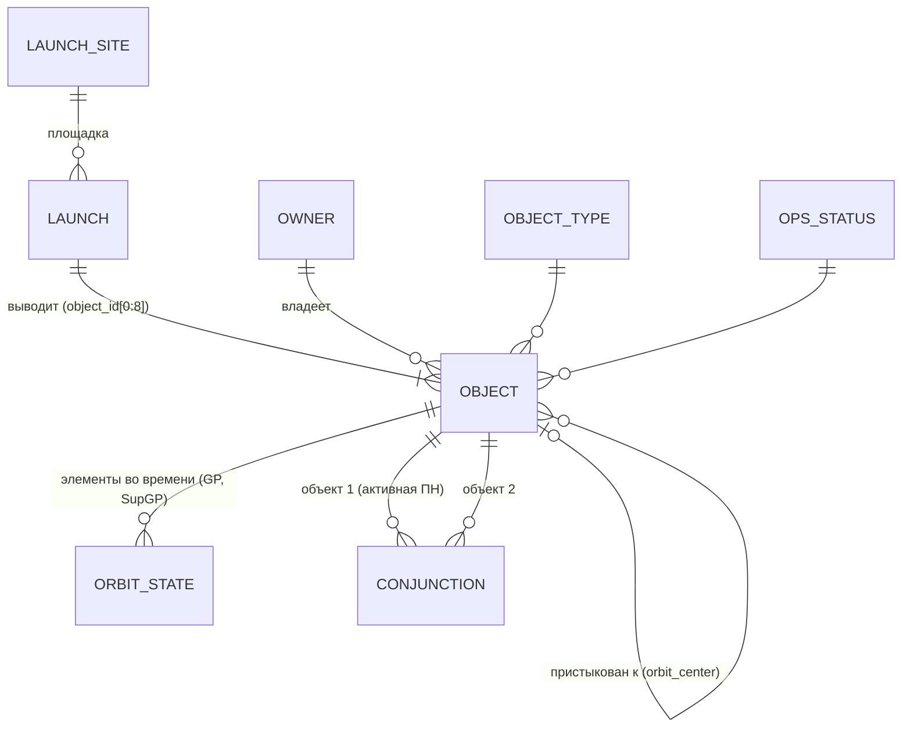

# Предметная область: космические объекты на околоземной орбите

Документ описывает, *что* лежит в данных CelesTrak, как сущности связаны между собой
и какие особенности данных нужно учитывать при построении DDS (ЛР2) и витрин (ЛР3).
Определения полей и коды взяты из документации CelesTrak (ссылки в конце). Все цифры
профиля получены запросами к `ods.*` по первым снимкам от 16.10.2026.

## 1. Зачем это анализировать

Околоземное пространство быстро заполняется. По данным SATCAT, число запусков выросло
с 97 в 2019 г. до 315 в 2025 г., а число выведенных полезных нагрузок — с 453 до 4 492 в год:

| Год | 2019 | 2020 | 2021 | 2022 | 2023 | 2024 | 2025 | 2026* |
|---|---:|---:|---:|---:|---:|---:|---:|---:|
| Запусков | 97 | 104 | 135 | 179 | 212 | 254 | 315 | 234 |
| Полезных нагрузок | 453 | 1 235 | 1 768 | 2 393 | 2 867 | 2 797 | 4 492 | 3 481 |

\* по 14.10.2026.

Чем больше объектов, тем больше опасных сближений и тем выше риск цепной реакции
столкновений (синдром Кесслера). Проект отвечает на вопросы: кто и что выводит на орбиту,
как распределены объекты по орбитам, где и между кем возникают опасные сближения, какие
объекты скоро сойдут с орбиты.

## 2. Ключевые понятия

| Термин | Значение | Где в данных |
|---|---|---|
| **NORAD Catalog Number** (SATCAT number) | Уникальный номер объекта в каталоге Космических сил США. Главный ключ во всех наборах. 11.07.2026 закончились пятизначные номера, новые объекты получают номера от 100000 | `norad_cat_id` |
| **International Designator** (COSPAR ID) | `ГГГГ-NNNA..`: год запуска, порядковый номер запуска в году, буквы — части одного запуска (A — обычно основная нагрузка) | `object_id`; первые 8 символов = идентификатор **запуска** |
| **Payload / Rocket body / Debris** | Полезная нагрузка (спутник), ступень ракеты, обломок | `object_type` = PAY / R/B / DEB / UNK |
| **Decay** | Сход с орбиты (сгорание в атмосфере, посадка, падение) | `decay_date`, `ops_status_code = D` |
| **Active** | Объект со статусом `+`, `P`, `B`, `S` или `X`. Электропитание и связь для этого не требуются, например у геодезических спутников | `ops_status_code` |
| **GP (General Perturbations)** | Набор средних элементов орбиты для модели SGP4, по которым можно предсказать положение объекта | `ods.gp`, `ods.supgp` |
| **OMM** | Стандарт CCSDS 502.0-B-3 для передачи элементов орбиты. Современная замена формата TLE, которая поддерживает шестизначные номера | формат JSON, который мы забираем |
| **Epoch** | Момент времени (UTC), к которому относятся элементы орбиты | `epoch` |
| **SupGP** | Элементы, рассчитанные CelesTrak по эфемеридам **оператора** (у Starlink — SpaceX), а не по радарным наблюдениям | `ods.supgp`, `data_source`, `rms` |
| **Conjunction** | Сближение двух объектов ближе порога (у SOCRATES 5 км) | `ods.socrates` |
| **TCA** | Time of Closest Approach — момент наибольшего сближения, UTC | `tca` |

### Элементы орбиты (GP / OMM)

| Поле | Смысл | Единицы |
|---|---|---|
| `mean_motion` | среднее движение: число витков в сутки | об/сут |
| `eccentricity` | эксцентриситет: 0 — круговая орбита, ближе к 1 — сильно вытянутая | — |
| `inclination` | наклонение плоскости орбиты к экватору (>90° — ретроградная орбита) | ° |
| `ra_of_asc_node` | долгота восходящего узла (RAAN) | ° |
| `arg_of_pericenter` | аргумент перигея | ° |
| `mean_anomaly` | средняя аномалия (положение на орбите в момент epoch) | ° |
| `bstar` | коэффициент торможения в атмосфере (модель SGP4); значимо отличается от нуля на низких орбитах | 1/радиус Земли |
| `mean_motion_dot`, `mean_motion_ddot` | производные среднего движения, служебные параметры SGP4 | — |
| `element_set_no`, `rev_at_epoch` | номер набора элементов; номер витка на момент epoch | — |

**Производные величины.** Их нет в источнике, они будут рассчитываться в DDS:

```
период, мин          T = 1440 / mean_motion
большая полуось, км  a = (μ / n²)^(1/3),  μ = 398 600.4418 км³/с²,  n = mean_motion · 2π / 86 400 рад/с
высота перигея, км   a·(1 − e) − 6 378.137
высота апогея, км    a·(1 + e) − 6 378.137
```

**Орбитальный режим.** Правила классификации, принятые в проекте, с распределением по снимку GP:

| Режим | Правило | Объектов в GP |
|---|---|---:|
| LEO — низкая | `mean_motion > 11.25` и `e < 0.25` | 15 942 |
| GEO — геостационарная | `0.99 ≤ mean_motion ≤ 1.01` и `e < 0.01` | 570 |
| HEO — высокоэллиптическая | `e ≥ 0.25` | 45 |
| MEO и прочие (навигационные GPS/ГЛОНАСС/Galileo и др.) | остальное | 195 |

## 3. Наборы данных

### 3.1 SATCAT — каталог объектов
*Одна строка — один объект за всю историю, с 1957 г.* Снимок: 71 073 объекта, ключ `norad_cat_id`
(уникален, как и `object_id`). Пополняется по мере каталогизации новых объектов;
мы забираем его раз в сутки, неизменившийся файл отбрасывается по sha256.

| Поле | Смысл / единицы |
|---|---|
| `object_name` | название. `R/B(1)` и `R/B(2)` — 1-я и 2-я ступени; `DEB` — обломок; `PLAT` — платформа; в скобках альтернативное имя; `&` — объекты, соединённые при запуске |
| `object_id`, `norad_cat_id` | COSPAR ID и NORAD ID, см. выше |
| `object_type` | PAY / R/B / DEB / UNK |
| `ops_status_code` | операционный статус, см. §4 |
| `owner` | страна или организация-владелец (130 кодов: `US`, `CIS`, `PRC`, `FR`, `JPN`, `IND`, `ESA`, …; `TBD` — не определено) |
| `launch_date`, `launch_site` | дата и площадка запуска (38 кодов: `AFETR` — мыс Канаверал, `AFWTR` — Ванденберг, `PLMSC` — Плесецк, `TYMSC` — Байконур, `TAISC` — Тайюань, `FRGUI` — Куру, …) |
| `decay_date` | дата схода; пусто, если объект ещё на орбите |
| `period` / `inclination` / `apogee` / `perigee` | период, мин / наклонение, ° / высоты апогея и перигея, км |
| `rcs` | эффективная площадь рассеяния (радарный размер), м² |
| `data_status_code` | `NCE` — нет текущих элементов, `NIE` — нет начальных, `NEA` — элементы недоступны |
| `orbit_center` | вокруг чего обращается: `EA` — Земля, `MO` — Луна, `SU` — Солнце, `MA` — Марс, `EL1`/`EL2` — точки Лагранжа и т. д. **Если указан NORAD ID**, объект пристыкован к нему (например, модули МКС → `25544`) |
| `orbit_type` | `ORB` — на орбите, `IMP` — упал или сгорел, `LAN` — посадка, `DOC` — пристыкован, `R/T` — полёт с возвратом |

### 3.2 GP — орбиты активных спутников
*Одна строка — последние элементы орбиты одного активного объекта на момент загрузки.*
Снимок: 16 752 объекта, `norad_cat_id` уникален в пределах снимка. Каждая загрузка добавляет
снимок, история снимков даёт **временные ряды** орбит. CelesTrak получает новые данные
каждые 2 часа; сами элементы 18 SDS обновляются 2–3 раза в сутки на объект.

### 3.3 SupGP Starlink — орбиты по данным оператора
Тот же набор полей OMM плюс `rms` (оценка точности подгонки к эфемеридам оператора;
единицы на странице CelesTrak не указаны) и `data_source` (источник,
например `SpaceX-E`). Те же объекты, что и в GP, но рассчитанные по эфемеридам оператора.
Поэтому для одного `norad_cat_id` в одно время есть **две оценки орбиты**.

### 3.4 SOCRATES — прогноз сближений
*Одна строка — одно прогнозируемое сближение пары объектов в момент TCA.* Окно — 7 суток вперёд,
порог — 5 км, 3 расчёта в сутки. Первым объектом всегда идёт **активная полезная нагрузка**,
она проверяется против всего каталога. Сближения внутри одной группировки между полностью
работающими спутниками исключаются. Снимок: 195 841 сближение, 143 263 уникальные пары.

| Поле | Смысл / единицы |
|---|---|
| `norad_cat_id_1/2`, `object_name_1/2` | участники; в имени в скобках статус объекта: `[+]`, `[-]`, `[P]`, `[?]` |
| `dse_1/2` | Days Since Epoch: сколько суток прошло от epoch использованных элементов до TCA. Чем больше, тем менее точен прогноз |
| `tca` | момент наибольшего сближения, UTC |
| `tca_range` | расстояние в момент TCA (минимальная дистанция), км |
| `tca_relative_speed` | модуль относительной скорости в TCA, км/с; показывает энергию возможного удара |
| `max_prob` | максимально возможная вероятность столкновения при самой неблагоприятной ориентации эллипса ошибок (погрешности 100/300/100 м по радиальной, вдоль-трековой и поперечной осям). Если сумма радиусов объектов больше `tca_range`, равна 1 |
| `dilution` | порог разбавления, км. Если реальная неопределённость больше порога, расчёт вероятности ненадёжен и нужно ориентироваться на `max_prob` |

## 4. Справочник статусов (`ops_status_code`)

| Код | Значение | Active | В SATCAT |
|---|---|:---:|---:|
| `+` | работает | ✔ | 16 846 |
| `P` | частично работает (основная или дополнительная миссия выполняется частично) | ✔ | 437 |
| `B` | резерв (ранее работал, переведён в резерв) | ✔ | 24 |
| `S` | запасной (новый, ждёт полного ввода в строй) | ✔ | 5 |
| `X` | продлённая миссия | ✔ | 16 |
| `-` | не работает | | 1 495 |
| `D` | сошёл с орбиты | | 35 713 |
| `?` | неизвестно | | 0* |
| NULL | статус не присвоен | | 16 537 |

\* в SATCAT не встречается, но есть в именах объектов SOCRATES (`[?]`, 4 971 строка).

NULL почти полностью приходится на объекты, которые **ещё на орбите** и для которых статус
не имеет смысла. Например, у обломков NULL ровно 12 550, и столько же обломков на орбите.
Сошедшим объектам проставлен `D`.

## 5. Сущности и связи



| Сущность | Ключ | Источник | Что меняется во времени → кандидат в SCD2 |
|---|---|---|---|
| Объект | `norad_cat_id` | SATCAT | `object_name`, `ops_status_code`, `owner`, `decay_date`, `orbit_type`, `data_status_code` — **SCD2** |
| Запуск | `substr(object_id, 1, 8)` | SATCAT | не меняется (6 972 запуска) |
| Владелец, площадка, тип, статус | код | SATCAT + справочники CelesTrak | статичные справочники |
| Состояние орбиты | `(norad_cat_id, epoch, source)` | GP, SupGP | факт (append-only) |
| Сближение | `(min(id1,id2), max(id1,id2), tca)` | SOCRATES | факт; прогноз уточняется от расчёта к расчёту |

В DDS (Data Vault 2.0, [отчёт ЛР2](../reports/lr2/report.md)) эти сущности стали:
объект → `hub_object` + сателлиты `sat_object_satcat_desc` / `_status`; запуск → `hub_launch` +
`sat_launch`; состояние орбиты → сателлиты `sat_object_orbit_gp` / `_supgp`; сближение →
`link_conjunction` + `sat_conjunction` (multi-active) + `sts_conjunction`; коды статуса и типа →
`ref_ops_status`, `ref_object_type`.

## 6. Особенности данных → правила для DDS и Data Quality

| # | Наблюдение (по данным) | Следствие |
|---|---|---|
| 1 | Группа `active` в GP **в точности** равна объектам SATCAT со статусами `+ P B S X` (16 283 + 431 + 24 + 9 + 5 = 16 752) | проверка согласованности GP и SATCAT в DQ |
| 2 | Все 16 752 объекта GP есть в SATCAT | FK `orbit_state → object` выполним |
| 3 | 319 объектов SOCRATES **отсутствуют** в SATCAT, номера от 81021 до 290010. Это служебные «аналитические» объекты 18 SDS (диапазоны 8xxxx и 27xxxx+) | в `dim_object` нужен **неизвестный член** («inferred member»), иначе FK сломается |
| 4 | В SOCRATES `norad_cat_id_1 > norad_cat_id_2` в 44 596 строках: пары не упорядочены | для ключа пары упорядочивать `(least, greatest)` |
| 5 | Одна пара в течение недели сближается многократно (до 6+ раз) | гранулярность факта — (пара, TCA), а не пара |
| 6 | SOCRATES каждые ~8 ч пересчитывает тот же 7-дневный горизонт | дедупликация по (пара, TCA ± допуск); последний расчёт — самый точный |
| 7 | У CXO и XMM-Newton (высокоэллиптические орбиты) `epoch` на ~1.2 суток **позже** момента загрузки | правило DQ «epoch ≤ loaded_at» неверно; допускать до +2 суток |
| 8 | Самый старый epoch в активном GP — 27 сут. назад (39 объектов старше 7 суток) | метрика свежести: доля элементов старше N суток |
| 9 | В SATCAT нет номеров 70000–99999; после 69999 сразу идёт 100000+ | тип ключа — `INTEGER`, а не 5 символов; TLE не использовать |
| 10 | `orbit_center` хранит то код тела, то NORAD ID носителя (модули МКС → `25544`) | разделить на `orbit_center_code` и `docked_to_norad_id` |
| 11 | `apogee`, `perigee` и `period` в SATCAT — справочные значения, у GP свежее | для текущей орбиты брать производные из GP |
| 12 | Даты в SATCAT без времени, TCA и epoch — UTC без указания пояса | хранить как `timestamp` в UTC, `dim_date` строить по UTC |

Диапазоны значений для DQ: `0 ≤ inclination ≤ 180`, `0 ≤ eccentricity < 1`, `mean_motion > 0`,
`0 < tca_range ≤ 5`, `0 ≤ max_prob ≤ 1`, `tca` в пределах [`loaded_at` − 1 сут, `loaded_at` + 7 сут].
Все эти правила выполняются на текущих данных. Окно TCA отсчитывается не от `loaded_at`:
расчёт SOCRATES делается раньше скачивания, поэтому в снимке от 20:19 самые ранние TCA
относятся к 02:00 того же дня.

## 7. Аналитические вопросы → витрины (ЛР3)

| Вопрос | Данные | Витрина `mart.*` |
|---|---|---|
| Как объекты распределены по орбитам, типам и владельцам сейчас? | SATCAT + GP | `orbit_population` |
| Как росла населённость орбиты с 1957 года, когда случались разрушения? | SATCAT | `catalog_growth`, `chronicle` |
| Как растёт число запусков, какая доля у Starlink, откуда запускают? | SATCAT | `launch_activity`, `launch_sites` |
| Где на низкой орбите теснее всего? | GP | `altitude_shells` |
| Какие сближения самые опасные, какие объекты участвуют в них чаще всего и где они происходят? | SOCRATES + SATCAT + GP | `conjunction_risk`, `conjunction_geo` |
| Насколько орбиты оператора расходятся с «официальными»? | GP vs SupGP | `gp_vs_supgp` |
| Насколько свежие и полные данные? | `meta.*`, DQ | `pipeline_health`, `dq_checks` |

Вопросы о сходе с орбиты (падение перигея, BSTAR) и росте отдельных группировок во времени
требуют длинной истории снимков GP; на текущей (с 16.10.2026) они не дают вывода, поэтому
витрины `decay_watch` и `constellation_growth` из первоначального плана не строились.
Подробности и выводы — в [отчёте ЛР3](../reports/lr3/report.md).

## Источники
- SATCAT: формат и коды — https://celestrak.org/satcat/satcat-format.php,
  статусы — https://celestrak.org/satcat/status.php,
  владельцы — https://celestrak.org/satcat/sources.php,
  площадки — https://celestrak.org/satcat/launchsites.php
- GP / OMM: https://celestrak.org/NORAD/documentation/gp-data-formats.php,
  определения полей — CCSDS 502.0-B-3 (Orbit Data Messages), табл. 4-1
- SOCRATES: https://celestrak.org/SOCRATES/, поля CSV — https://celestrak.org/SOCRATES/socrates-format.php
