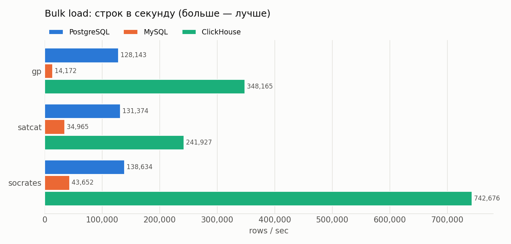
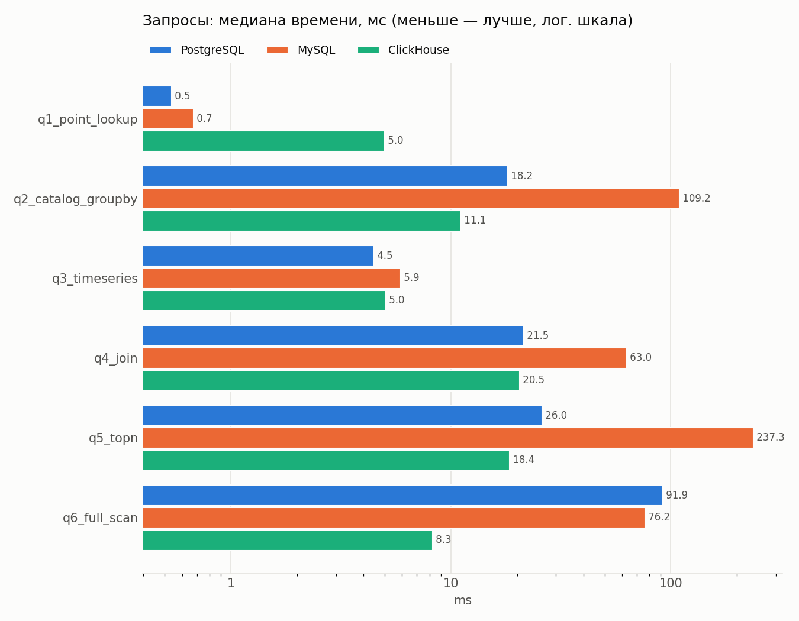
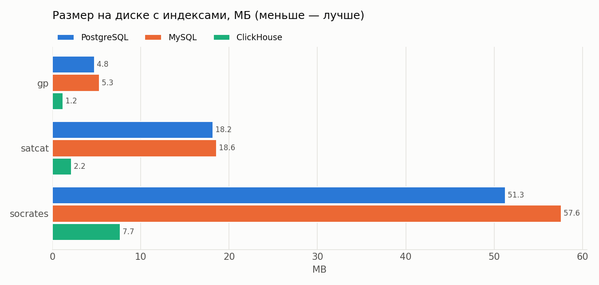

# Отчёт по лабораторной работе №1 «Работа с Airflow. ETL-процесс»

## 1. Тема и источники данных

Предметная область — космические объекты на околоземной орбите. Источник — открытый
сервис [CelesTrak](https://celestrak.org), публикующий данные NORAD/18 SDS и операторов
спутниковых группировок. Логически источник разделён на 4 набора, каждый грузит свой DAG:

| Набор | Эндпоинт | Формат | Что содержит | Роль в будущем DDS |
|---|---|---|---|---|
| SATCAT | `/pub/satcat.csv` | CSV | все объекты с 1957 г.: владелец, тип, даты запуска/схода, площадка, RCS | измерение «объект» (SCD2) |
| GP | `/NORAD/elements/gp.php?GROUP=active&FORMAT=json` | JSON (OMM) | орбитальные элементы активных спутников | факт «состояние орбиты» |
| SupGP | `/NORAD/elements/supplemental/sup-gp.php?FILE=starlink&FORMAT=json` | JSON (OMM) | элементы Starlink по эфемеридам SpaceX + точность `RMS` | факт «состояние орбиты» (второй источник) |
| SOCRATES | `/SOCRATES/sort-minRange.csv` | CSV | прогноз сближений пар объектов на 7 дней: TCA, дистанция, вероятность | факт «сближение» |

Наборы связаны ключом `NORAD_CAT_ID`, что позволит в ЛР2 построить снежинку.

**Ограничения источника (проверены на практике).** CelesTrak отвечает 403 на повторный запрос
того же набора до его обновления: `SupGP data has not updated since last successful FILE=starlink
download … Please limit requests to once every 2 hours`. Поэтому расписания DAG не чаще 4 ч,
а 403 обрабатывается как штатный пропуск, без повторов (повторы приводят к блокировке IP).

## 2. Архитектура

```
CelesTrak ──► Airflow: ingest_satcat / ingest_gp / ingest_supgp / ingest_socrates
                │ extract: 1 HTTP-запрос, валидация, sha256
                ├──► SeaweedFS (S3)   s3://raw/<source>/dt=YYYY-MM-DD/<load_id>.<csv|json>
                │ load_ods: парсинг + приведение типов, COPY
                ├──► PostgreSQL       ods.<source>  (снимки, append-only) + meta.raw_files / meta.load_log
                │ validate: полнота снимка → Airflow Asset ods_<source>  (триггер для DDS в ЛР2)
                ▼
         storage_benchmark (вручную): ODS → CSV (s3://exports) → PostgreSQL | MySQL | ClickHouse
```

Все сервисы описаны в [`docker-compose.yml`](../../docker-compose.yml):

| Сервис | Образ | Назначение |
|---|---|---|
| airflow-apiserver / scheduler / dag-processor / triggerer | `apache/airflow:3.0.6` + зависимости ([Dockerfile](../../airflow/Dockerfile)) | оркестрация, LocalExecutor |
| airflow-postgres | `postgres:16.4` | метаданные Airflow |
| seaweedfs | `chrislusf/seaweedfs:3.80` | хранилище сырых файлов (S3 API) |
| dwh-postgres | `postgres:16.4` | ODS + служебная схема `meta` |
| mysql *(профиль compare)* | `mysql:8.4.3` | участник сравнения |
| clickhouse *(профиль compare)* | `clickhouse/clickhouse-server:24.8.4.13` | участник сравнения |

**Почему так.** Сырые файлы хранятся отдельно от СУБД в объектном хранилище. Это дешёвый
неизменяемый архив: по нему можно повторить любую обработку без повторного обращения к API,
что важно при жёстких лимитах CelesTrak. SeaweedFS выбран как свободная (Apache 2.0)
S3-совместимая замена MinIO, открытый репозиторий которой архивирован.
Сравниваемые СУБД представляют три разных класса: классическую OLTP с богатым SQL (PostgreSQL),
вторую популярную OLTP (MySQL/InnoDB) и колоночную OLAP (ClickHouse). Все три свободные.

MySQL и ClickHouse вынесены в профиль `compare`: в штатном режиме ETL пишет только в PostgreSQL,
а копии в остальные СУБД создаёт `storage_benchmark` из CSV-экспорта ODS. Так данные
гарантированно одинаковы во всех трёх СУБД, API вызывается один раз, а постоянно работающий
стек занимает меньше ресурсов.

## 3. ETL-процессы

Код: фабрика DAG [`plugins/celestrak/ingest.py`](../../plugins/celestrak/ingest.py), DAG-файлы `dags/ingest_*.py`.

| Задача | Что делает |
|---|---|
| `extract` | HTTP GET с User-Agent и повторами при 5xx и таймаутах; 403 → *skipped*. Проверяет, что ответ — непустой CSV или JSON-массив: на ошибочный запрос CelesTrak отвечает 200 с текстом ошибки. Если sha256 совпадает с последним загруженным файлом, запуск пропускается. Файл кладётся в S3 и регистрируется в `meta.raw_files`. |
| `load_ods` | Читает файл из S3 и разбирает его по схеме источника ([`sources.py`](../../plugins/celestrak/sources.py)): имена колонок в snake_case, приведение типов, пустая строка → NULL, отбрасываются строки без NORAD ID. Добавляет технические поля `load_id`, `loaded_at`, `source_file` и загружает снимок через `COPY` в одной транзакции. Перед вставкой удаляются строки с тем же `load_id`, поэтому ретрай не создаёт дублей. Результат пишется в `meta.load_log`. |
| `validate` | Проверяет, что число строк снимка в БД равно числу разобранных строк. Публикует Asset `ods_<source>`. |

DDL: [`sql/ods/postgres`](../../sql/ods/postgres), [`sql/ods/mysql`](../../sql/ods/mysql),
[`sql/ods/clickhouse`](../../sql/ods/clickhouse). Схема ODS одинакова во всех СУБД; физическое
устройство учитывает особенности каждой: B-tree индексы `(norad_cat_id, epoch)` и `loaded_at`
в PostgreSQL и MySQL; `MergeTree ORDER BY (norad_cat_id, loaded_at)`, `PARTITION BY` месяц и
`LowCardinality` для справочных строк в ClickHouse.

Первая загрузка (16.10.2026):

| Источник | Файл | Строк в ODS | Загрузка в PostgreSQL |
|---|---:|---:|---:|
| satcat | 6.5 МБ | 71 073 | 0.67 с |
| gp | 6.7 МБ | 16 752 | 0.21 с |
| socrates | 21.2 МБ | 195 841 | 2.43 с |
| supgp | — | — | пропуск: 403 (набор скачивался вручную при исследовании API за 12 минут до запуска) |

Unit-тесты разбора и валидации: [`tests/test_parsing.py`](../../tests/test_parsing.py), 10 тестов.

## 4. Сравнение хранилищ

### Методика
DAG [`storage_benchmark`](../../dags/storage_benchmark.py) выгружает ODS из PostgreSQL в CSV
и **последовательно** прогоняет каждую СУБД, чтобы они не конкурировали за CPU и диск:

1. **Загрузка** одного и того же CSV штатным bulk-методом СУБД: `COPY` / `LOAD DATA LOCAL INFILE` /
   вставка `CSVWithNames` (в PostgreSQL — в отдельную схему `bench`, чтобы не трогать ODS).
   После загрузки сверяется число строк.
2. **Запросы**, отражающие реальные сценарии будущих витрин
   ([`benchmark.py`](../../plugins/celestrak/benchmark.py)): поиск по ключу, GROUP BY по каталогу,
   временной ряд, JOIN каталога с орбитами, top-N, полный скан с агрегатами. Один прогрев,
   затем медиана из 5 запусков.
3. **Размер на диске** с индексами (`pg_total_relation_size`, `information_schema.tables`,
   `system.parts`).

Конфигурации СУБД по умолчанию, один хост (Docker Desktop, WSL2, 20 vCPU, 12 ГБ RAM),
данные — первый снимок каждого набора (~284 тыс. строк).

### Результаты
Полные таблицы — [results.md](results.md), сырые замеры — `meta.benchmark_results`.







| Критерий | PostgreSQL | MySQL | ClickHouse |
|---|---|---|---|
| Скорость загрузки (SOCRATES, строк/с) | 139 тыс. | 44 тыс. | **743 тыс.** |
| Поиск по ключу (q1) | **0.5 мс** | 0.7 мс | 5.0 мс |
| Аналитические запросы q2, q4–q6 | 18–92 мс | 63–237 мс | **8–21 мс** |
| Размер SOCRATES на диске | 51 МБ | 58 МБ | **7.7 МБ** (сжатие ×6.7) |
| Транзакции, внешние ключи, UPSERT | **полные** | полные | нет FK; UPDATE/DELETE — мутации |
| SCD2 / нормализация 3НФ (ЛР2) | **естественно** | естественно | неудобно |
| Поддержка в Superset и OpenMetadata (ЛР3) | **нативная** | нативная | нативная |
| Лицензия | PostgreSQL (свободная) | GPLv2 | Apache 2.0 |
| Ресурсы и эксплуатация | низкие | низкие | выше (ulimits, память под merge) |

### Выводы
* **ClickHouse** лидирует там, где важна аналитика: загрузка в 2–5 раз быстрее, полный скан
  в 11 раз быстрее PostgreSQL, данные занимают в 4–8 раз меньше места. Это следствие
  колоночного хранения и сжатия. Точечный поиск при этом медленнее (5 мс против 0.5 мс),
  нет транзакций и внешних ключей.
* **MySQL** на этой нагрузке не выигрывает ни в одном измерении: медленнее всех грузит,
  отстаёт от PostgreSQL на GROUP BY и top-N в 6–9 раз. Вероятные причины (по планам не проверялись):
  однопоточное выполнение запроса и отсутствие покрывающего индекса для фильтра
  `loaded_at = (SELECT max(...))` вместе с сортировкой.
* **PostgreSQL** — лучший баланс: самый быстрый поиск по ключу, сопоставимый с ClickHouse
  JOIN и временной ряд, а также полная транзакционность, FK, `ON CONFLICT` и `MERGE`.
  Всё это нужно для DDS со SCD2 в ЛР2.

**Выбор:** PostgreSQL — основное хранилище ODS, DDS и витрин. ClickHouse — кандидат для
аналитических витрин, если объём истории вырастет. Оценка роста: GP около 100 тыс. строк в сутки,
SOCRATES до 400 тыс., то есть больше 10 млн строк в месяц; на таком объёме преимущество
колоночного хранения будет заметнее. Бенчмарк можно перезапустить в любой момент: он берёт
весь накопленный ODS.

**Ограничения эксперимента:** небольшой объём (один снимок), «тёплые» кэши, настройки СУБД
по умолчанию (`shared_buffers` и `innodb_buffer_pool_size` по 128 МБ), один хост.

## 5. Демонстрация
1. `docker compose up -d --build && docker compose --profile compare up -d`
2. Airflow http://localhost:8080 (airflow/airflow): DAG `ingest_*` с тегом `lr1`, граф
   `extract → load_ods → validate`, журнал пропуска с 403.
3. Сырые файлы: http://localhost:8888/buckets/raw/
4. Данные: PostgreSQL `localhost:5433/dwh` (`ods.*`, `meta.*`), MySQL `localhost:3307/ods`,
   ClickHouse http://localhost:8123/play (`SELECT count() FROM ods.socrates`).
5. Сравнение: запустить `storage_benchmark`, результаты в `reports/lr1/`.
