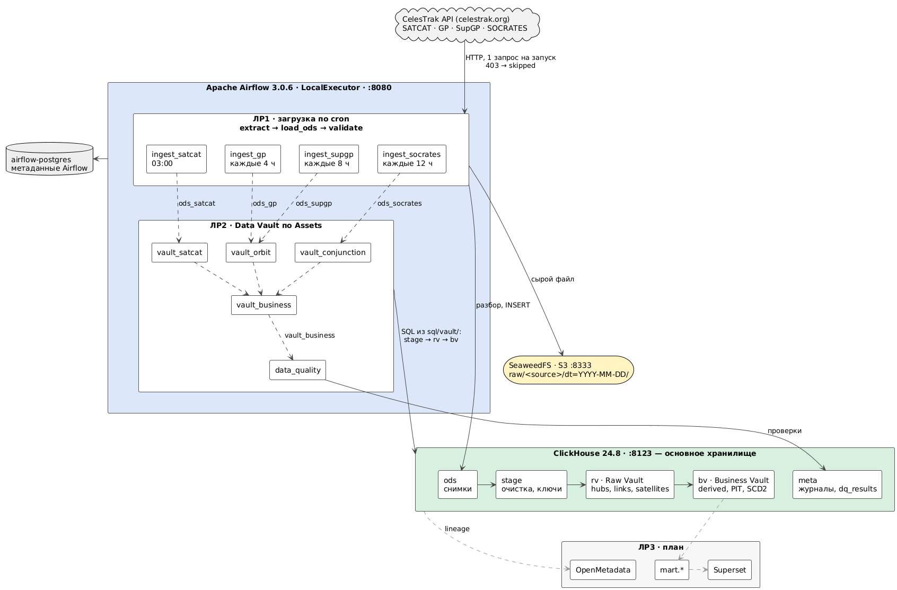
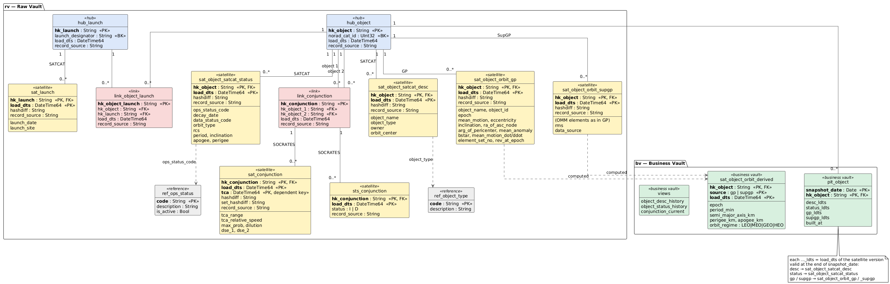

# Отчёт по лабораторной работе №2 «Нормализация данных. Data Quality»

## 1. Задача и выбор модели

Нужно построить детальный слой (DDS) на сырых данных ЛР1: очистка, трансформация,
отслеживание изменений (SCD), зависимости между ETL-процессами и проверки качества.

ТЗ предлагает звезду или снежинку в 3НФ и допускает «альтернативный трек обработки данных
для экзотических источников». Для CelesTrak выбран **Data Vault 2.0**:

| Свойство данных CelesTrak | Почему это подходит DV2 |
|---|---|
| Есть устойчивые бизнес-ключи: NORAD ID объекта и номер запуска (`1998-067A` → `1998-067`) | они становятся **хабами** |
| Один объект описывают 4 независимых источника (SATCAT, GP, SupGP, SOCRATES) | у каждого источника свой **сателлит** на общем хабе, источники не перезаписывают друг друга |
| Данные приходят полными снимками, история важна | сателлиты только дописываются, новая версия — при изменении → история (SCD2) по построению |
| 344 объекта есть в GP/SOCRATES, но отсутствуют в SATCAT | в звезде это нарушение внешнего ключа; в DV2 для них просто создаётся хаб |
| Источники обновляются в разное время (от 4 ч до суток) | каждый источник грузится независимо, без ожидания других |

Как закрываются пункты ТЗ:

| Пункт ТЗ | Реализация |
|---|---|
| 1. Структура, 3НФ | hubs / links / satellites: каждый атрибут хранится один раз, у ключа; связи — отдельно (§3) |
| 2. Очистка, приведение типов, обогащение, агрегация | staging (§4.1), business vault: орбитальная геометрия и PIT (§6) |
| 3. SCD | сателлиты insert-only с `hashdiff` + представления SCD2 `valid_from/valid_to/is_current` (§5) |
| 4. Зависимости ETL | Airflow Assets — альтернатива сенсорам (§7) |
| 5. Data Quality | DAG `data_quality`, 15 проверок (§8) |

DDS построен в **ClickHouse**, который с 17.10 стал основным хранилищем (обоснование и
перенос данных — в [отчёте ЛР1](../lr1/report.md), раздел «Пересмотр выбора»).

## 2. Архитектура слоя

Вся система (PlantUML, исходник [`diagrams/architecture.puml`](../../diagrams/architecture.puml);
сплошные стрелки — поток данных, пунктир — события Airflow Assets, серое — план ЛР3):



Путь данных внутри ClickHouse:

```
ods.* (ClickHouse) ─► stage.<source> ─► rv.*  Raw Vault ─► bv.*  Business Vault ─► (ЛР3: витрины)
   снимки ЛР1          очистка, ключи     hubs, links,       вычисляемые атрибуты,
                       и хэши одного      satellites         PIT, SCD2-представления
                       снимка
```

| Слой | База ClickHouse | Код |
|---|---|---|
| Staging | `stage` | [`sql/vault/load/<source>/00_stage.sql`](../../sql/vault/load) |
| Raw Vault | `rv` | DDL [`sql/vault/ddl/01_rv.sql`](../../sql/vault/ddl/01_rv.sql), загрузка `sql/vault/load/<source>/1x–4x_*.sql` |
| Business Vault | `bv` | DDL [`sql/vault/ddl/02_bv.sql`](../../sql/vault/ddl/02_bv.sql), расчёт [`sql/vault/bv/`](../../sql/vault/bv) |
| Журналы | `meta.vault_log`, `meta.dq_results` | [`sql/ods/clickhouse/02_meta.sql`](../../sql/ods/clickhouse/02_meta.sql) |
| Оркестрация | — | [`plugins/celestrak/vault.py`](../../plugins/celestrak/vault.py), [`vault_dag.py`](../../plugins/celestrak/vault_dag.py), [`dq.py`](../../plugins/celestrak/dq.py), `dags/vault_*.py`, `dags/data_quality.py` |

## 3. Модель Raw Vault

Полная схема с колонками (PlantUML, исходник
[`diagrams/data_vault.puml`](../../diagrams/data_vault.puml)):




| Таблица | Ключ | Источник | Строк (17.10) | Что хранит |
|---|---|---|---:|---|
| `hub_object` | NORAD ID | все 4 | 71 417 | объект |
| `hub_launch` | номер запуска | satcat | 6 972 | запуск |
| `link_object_launch` | объект + запуск | satcat | 71 073 | какой объект каким запуском выведен |
| `link_conjunction` | упорядоченная пара объектов | socrates | 215 647 | пара объектов, сближавшаяся хоть раз |
| `sat_object_satcat_desc` | объект, `load_dts` | satcat | 71 073 | имя, тип, владелец, центр орбиты — меняются редко |
| `sat_object_satcat_status` | объект, `load_dts` | satcat | 71 073 | статус, дата схода, RCS, период, высоты — меняются часто |
| `sat_launch` | запуск, `load_dts` | satcat | 6 972 | дата и площадка запуска |
| `sat_object_orbit_gp` | объект, `load_dts` | gp | 53 299 | элементы орбиты по радарам 18 SDS |
| `sat_object_orbit_supgp` | объект, `load_dts` | supgp | 22 302 | элементы по эфемеридам SpaceX + `rms`, `data_source` |
| `sat_conjunction` | пара, `load_dts`, TCA | socrates | 390 352 | прогноз сближения (multi-active) |
| `sts_conjunction` | пара, `load_dts` | socrates | 288 195 | статус пары: `I` — в прогнозе, `D` — выпала |
| `ref_ops_status`, `ref_object_type` | код | справочник | 8, 4 | расшифровка кодов |

Решения моделирования:
- **Атрибуты SATCAT разделены на два сателлита по скорости изменения** (приём DV2): описание
  объекта почти не меняется, а статус и параметры орбиты обновляются часто. Так изменение
  высоты не создаёт новую версию имени и владельца.
- **Дата и площадка — атрибуты запуска, а не объекта**: они вынесены в `hub_launch` +
  `sat_launch`. Это нормализация: в SATCAT они повторяются у всех ~10 объектов одного запуска.
- **GP и SupGP — разные сателлиты** одного хаба: это одна сущность «состояние орбиты» из двух
  систем-источников, их расхождение — тема витрины ЛР3.
- **Сближение — линк**, а не хаб: у него нет собственного бизнес-ключа, оно определяется парой
  объектов. В одном прогнозе у пары может быть несколько TCA, поэтому `sat_conjunction` —
  multi-active сателлит с зависимым ключом `tca`; версия — весь набор TCA пары (`set_hashdiff`).
- **Status tracking satellite** `sts_conjunction` фиксирует, когда пара появилась в прогнозе и
  когда выпала из него. Без него «текущий прогноз» нельзя отличить от устаревшего.

Соглашения (единые для всех таблиц):
- hash key и hashdiff — hex MD5 нормализованных значений, склеенных через `||` (функция `dv_hash`);
- `load_dts` — момент скачивания снимка (`ods.loaded_at`), а не момент загрузки в vault, поэтому
  повторная загрузка того же снимка даёт тот же результат;
- `record_source` — путь к сырому файлу в S3: любую версию можно отследить до исходного файла.

## 4. Загрузка

### 4.1 Staging: очистка и подготовка снимка
Каждый ODS-снимок сначала попадает в `stage.<source>` (`00_stage.sql`):

| Операция | Где | Зачем |
|---|---|---|
| Дедупликация (`LIMIT 1 BY` ключ) | все источники | один ключ — одна строка в снимке |
| Нормализация пары: (меньший NORAD, больший NORAD), перестановка `dse_1/dse_2` | socrates | в источнике пары неупорядочены (~23% строк `id1 > id2`); без этого одна пара дала бы два линка |
| Отбрасывание пар объекта с самим собой и строк без TCA | socrates | такие строки не описывают сближение |
| Выделение номера запуска `YYYY-NNN` с проверкой формата | satcat | бизнес-ключ хаба запуска |
| Расчёт hash key и hashdiff | все | один раз на снимок, для всех следующих шагов |

Приведение типов выполнено ещё при загрузке ODS (ЛР1, `parsing.py`): в vault приходят
типизированные значения.

### 4.2 Hubs, links, satellites
Шаги идут по номерам файлов: хабы (`1x`) → линки (`2x`) → сателлиты (`3x`, `4x`).
- Хабы и линки: вставляются только ключи, которых ещё нет (`NOT IN`).
- Сателлиты: строка пишется, только если её `hashdiff` отличается от последней версии ключа на
  момент снимка (`argMax(hashdiff, load_dts) … WHERE load_dts <= снимок`). Неизменившиеся
  объекты не добавляют ничего.

Снимки грузятся по одному, от старых к новым; `meta.vault_log` хранит, какие уже загружены, и
сколько строк записал каждый шаг. Результат первичной загрузки всей истории ODS:

| Снимок | Строк в ODS | Новых версий в сателлите | Комментарий |
|---|---:|---:|---|
| `satcat_20261016T201814` | 71 073 | 71 073 + 71 073 + 6 972 | первая загрузка |
| `gp_20261016T201839` | 16 752 | 16 752 | первая загрузка |
| `gp_20261017T001503` | 16 754 | 9 343 | обновились элементы у 56% объектов |
| `gp_20261017T041504` | 16 754 | **1** | файл формально новый, но изменился один объект |
| `gp_20261017T081512` | 16 757 | 11 352 | |
| `gp_20261017T163553` | 16 754 | 15 851 | |
| `supgp_20261017T003004` | 11 152 | 11 152 | первая загрузка |
| `supgp_20261017T163553` | 11 151 | 11 150 | эфемериды SpaceX обновляются почти целиком |
| `socrates_20261016T201906` | 195 841 | 195 841 (143 263 пары) | первая загрузка |
| `socrates_20261017T163619` | 196 744 | 194 511 | 72 384 пары появились, 72 548 выпали из прогноза |

В ODS 83 771 строка GP, в сателлите — 53 299: дельта-загрузка не хранит повторы.

### 4.3 Особенности ClickHouse
В ClickHouse нет внешних ключей, уникальных ограничений и транзакций. Чем это компенсируется:

| Чего нет | Замена |
|---|---|
| UNIQUE / PRIMARY KEY | вставка только отсутствующих ключей; таблицы vault на ReplacingMergeTree схлопывают случайные дубли; проверка `duplicate_keys` |
| FOREIGN KEY | проверки `orphan_links`, `orphan_satellites` в DQ |
| транзакции | один INSERT атомарен; каждый шаг идемпотентен, поэтому упавшую загрузку можно просто повторить |
| блокировки при параллельной записи | pool Airflow `vault` на 1 слот: загрузки разных DAG в общий `hub_object` идут по очереди |

## 5. SCD2

История атрибутов — это сами сателлиты: каждая строка — версия, действующая с `load_dts` до
следующей версии. Для удобства созданы представления SCD2 в `bv`:

```sql
SELECT norad_cat_id, owner, valid_from, valid_to, is_current
FROM bv.object_desc_history WHERE norad_cat_id = 25544;
```

**Проверка.** В ODS был подставлен поддельный снимок SATCAT, где у МКС (25544) изменён
владелец, и запущен `vault_satcat`:

| norad_cat_id | owner | valid_from | valid_to | is_current |
|---|---|---|---|---|
| 25544 | ISS | 2026-10-16 20:18:14 | 2026-10-17 23:59:59 | false |
| 25544 | TEST | 2026-10-17 23:59:59 | NULL | true |

Из 71 073 объектов новая версия появилась ровно у одного; `sat_object_satcat_status` и
`sat_launch` не изменились (0 строк). После проверки поддельный снимок удалён.

Остальные SCD-сущности: `bv.object_status_history` (статус, сход с орбиты), все сателлиты орбит
и прогнозов (история по `load_dts`), `sts_conjunction` (интервалы присутствия пары в прогнозе).

## 6. Business Vault: обогащение и агрегация

**`bv.sat_object_orbit_derived`** — вычисляемый сателлит для каждой версии GP и SupGP
(формулы из [domain.md](../../docs/domain.md)):

| Атрибут | Формула |
|---|---|
| `period_min` | 1440 / mean_motion |
| `semi_major_axis_km` | (μ / n²)^(1/3), μ = 398 600.4418 км³/с², n в рад/с |
| `perigee_km`, `apogee_km` | a·(1 ∓ e) − 6378.137 |
| `orbit_regime` | HEO: e ≥ 0.25; GEO: 0.99 ≤ mm ≤ 1.01 и e < 0.01; LEO: mm > 11.25; иначе MEO |

Проверка на МКС: перигей 415 км, апогей 425 км, период 92.97 мин. Распределение текущих
орбит активных спутников: LEO 15 944, GEO 571, MEO 197, HEO 45.

**`bv.pit_object`** (point-in-time) — агрегирующая таблица для витрин: на каждый день и объект —
какая версия каждого сателлита действовала на конец дня (строится через `ASOF JOIN`). Витрине
не нужно искать «последнюю версию на дату» оконными функциями: достаточно соединения по
`(hk_object, load_dts)`.

**`bv.conjunction_current`** — текущий прогноз сближений: пары со статусом `I` и последней
версией их набора TCA.

## 7. Зависимости между ETL-процессами

Вместо сенсоров используются **Airflow Assets** (data-aware scheduling): задача-производитель
объявляет `outlets=[Asset]`, DAG-потребитель указывает этот Asset в `schedule` и стартует сразу
после обновления данных, без опроса.

```
ingest_satcat ──(ods_satcat)──────────────────► vault_satcat ──────┐
ingest_gp ─────(ods_gp)──┐                                         │
ingest_supgp ──(ods_supgp)┴─(ods_gp | ods_supgp)► vault_orbit ─────┼─(vault_satcat | vault_orbit
ingest_socrates ─(ods_socrates)───────────────► vault_conjunction ─┘    | vault_conjunction)
                                                                          ▼
                                                    vault_business ─(vault_business)─► data_quality
```

Почему Assets лучше сенсоров здесь: сенсор занимает слот и опрашивает состояние по таймеру, а
Asset-событие запускает потребителя ровно тогда, когда производитель успешно закончил. Если
`ingest_*` пропущен (403 или файл не изменился), Asset не публикуется и vault не запускается
впустую. Публикация из `vault_*` происходит только если загружен хотя бы один снимок
(`trigger_rule=none_failed_min_one_success`).

Подтверждение: после ручного запуска трёх DAG raw vault `vault_business` и `data_quality`
запустились сами (`run_type = asset_triggered`).

## 8. Data Quality

DAG `data_quality` запускается после `vault_business`. Каждая проверка — отдельный SQL-файл в
[`sql/dq/`](../../sql/dq) с заголовком (имя, критичность, описание); запрос возвращает строки-
нарушения. Число нарушений и до 5 примеров пишутся в `meta.dq_results`. Провал `critical`
роняет DAG, `warning` фиксируется.

| Проверка | Критичность | Что проверяет | 17.10 |
|---|---|---|---:|
| `hub_key_consistency` | critical | у каждого бизнес-ключа один hash key, и он равен MD5 ключа | 0 |
| `duplicate_keys` | warning | ещё не схлопнутые дубли ключей хабов и линков | 0 |
| `orphan_links` | critical | линки ссылаются на существующие хабы | 0 |
| `orphan_satellites` | critical | сателлиты висят на существующих хабах/линках | 0 |
| `satellite_redundant_versions` | critical | нет двух подряд одинаковых версий (дельта работает, интервалы SCD2 — настоящие изменения) | 0 |
| `ods_vault_reconciliation` | critical | **объёмы до/после**: все ключи последнего снимка каждого источника есть в vault | 0 |
| `vault_matches_snapshot` | critical | версия, действующая на момент последнего снимка, совпадает со снимком для каждого объекта | 0 |
| `orbit_element_ranges` | critical | **аномалии**: 0 ≤ e < 1, 0 ≤ наклонение ≤ 180, mean_motion > 0, есть epoch | 0 |
| `conjunction_ranges` | critical | **аномалии**: дистанция ≥ 0, скорость ≥ 0, 0 ≤ вероятность ≤ 1 | 0 |
| `derived_coverage` | critical | у каждой валидной версии орбиты есть строка business vault | 0 |
| `pit_complete` | critical | PIT на сегодня покрывает все объекты хаба | 0 |
| `launch_consistency` | warning | у всех объектов запуска одна дата и площадка | **1** |
| `objects_without_catalog` | warning | объекты из GP/SOCRATES, которых нет в SATCAT | **344** |
| `orbit_epoch_future` | warning | эпоха элементов больше чем на сутки позже скачивания | **2** |
| `gp_freshness` | warning | последний снимок GP моложе 8 ч | 0 |

Предупреждения — реальные особенности данных, а не ошибки загрузки:
- запуск `2019-032` записан с двумя площадками: `YSLA` и `SEAL` (морской старт Long March 11);
  в `sat_launch` берётся значение основного объекта (наименьший NORAD);
- 344 объекта отсутствуют в SATCAT (давно сошедшие и аналитические объекты, известные по SOCRATES);
- у двух объектов (25867 — CXO, 25989 — XMM-Newton) эпоха элементов в будущем: для высоких орбит
  CelesTrak публикует предсказанные элементы.

**Проверка, что DQ ловит ошибки.** В `sat_object_orbit_gp` была вставлена версия МКС с
эксцентриситетом 1.5. DAG `data_quality` упал, `orbit_element_ranges` вернула ровно эту строку:
```
('gp', '96045cb4…', '2026-10-17 23:59:58', 1.5, 51.6327, 15.48907033)
```
После удаления строки DAG снова зелёный. Ещё одно реальное срабатывание: после теста SCD2
`vault_matches_snapshot` обнаружила, что `stage.satcat` остался от поддельного снимка и не
совпадает с vault; пересборка staging из настоящего снимка (0 новых строк — идемпотентность)
вернула проверку в норму.

## 9. Наблюдения и ограничения

- **Объём vault.** Raw vault занимает 96 МБ против 22 МБ у ODS при меньшем числе строк. Причина —
  hash keys и hashdiff: случайные 32-символьные строки, которые колоночное сжатие не уменьшает
  (в строке `sat_conjunction` их три). Это известная цена DV2 в колоночной СУБД. Варианты
  уменьшения: хранить MD5 в бинарном виде (`FixedString(16)`, вдвое меньше), не хранить построчный
  `hashdiff` в multi-active сателлите, использовать сами NORAD ID как ключи (отказ от хэшей).
- **Эпохи vs снимки.** `load_dts` — момент скачивания, а не эпоха элементов: история сателлита
  отвечает на вопрос «что мы знали на момент X». Эпоха хранится как атрибут.
- **SOCRATES** пересчитывается дважды в сутки и сильно меняется (половина пар за 20 часов), поэтому
  `sat_conjunction` растёт быстрее остальных — кандидат на партиционирование и TTL.
- Объём данных пока небольшой (2 суток истории).

