# Отчёт по лабораторной работе №3 «Витрины данных. BI. Data Lineage»

## 1. Задача

На детальном слое ЛР2 (Data Vault в ClickHouse) нужно построить витрины, показать их в BI и
проследить происхождение данных в каталоге метаданных.

| Пункт ТЗ | Реализация |
|---|---|
| 1. Superset и OpenMetadata в общем docker-compose | профили `bi` (Superset, 3D-глобус) и `meta` (OpenMetadata, Elasticsearch, ingestion) (§2) |
| 2. Витрины из детального слоя с аналитическим выводом | 14 таблиц в базе `mart`: 9 SQL-витрин и 5 орбитальных на SGP4 (§3) |
| 3. Скрипт витрин — ETL-процесс, связанный с DAG детального слоя | DAG `build_marts` запускается по Asset `dq_passed` из `data_quality` (§4) |
| 4. Дашборд из 5+ визуализаций с обоснованием | «Околоземное пространство»: 13 графиков 10 типов; «Космос в 3D»: интерактивный глобус (§5) |
| 5. Lineage в OpenMetadata от источника до витрин | S3 → ods → stage → rv → bv → mart → Superset, 99 рёбер, выведены из SQL (§6) |
| 6. Отчёт | этот документ |

Все цифры ниже получены на данных от 30.10.2026.

## 2. Архитектура

Вся система — UML-диаграмма развёртывания (UML 2.5, исходник
[`diagrams/architecture.puml`](../../diagrams/architecture.puml)). Узлы `«device»` — машины,
`«executionEnvironment»` — контейнеры Docker (`имя : образ`), под чертой — что развёрнуто в
контейнере; стрелки — коммуникационные пути от клиента к серверу с протоколом и портом,
в скобках — Airflow Connection. Поток данных между слоями показан в §4 и в lineage (§6.2).


| Сервис | Профиль | Адрес | Назначение |
|---|---|---|---|
| Airflow, ClickHouse, SeaweedFS | — | :8080, :8123, :8333 | загрузка, DDS, витрины (ЛР1–ЛР3) |
| `superset` + `superset-init` + `superset-bootstrap` | `bi` | :8088 | BI; метаданные — в базе `superset` сервера `airflow-postgres` |
| `globe` (nginx) | `bi` | :8090 | 3D-глобус; `/ch/` проксирует запросы к ClickHouse от read-only пользователя |
| `openmetadata-server` + `openmetadata-migrate` | `meta` | :8585 | каталог; метаданные — в базе `openmetadata_db` сервера `airflow-postgres` |
| `om-elasticsearch` | `meta` | — | поисковый индекс OpenMetadata |
| `om-ingest` | `meta` | — | раз в час: ingestion, lineage, описания, тесты качества |

Запуск всего стенда: `docker compose --profile bi --profile meta up -d`. Отдельный Postgres
для Superset и OpenMetadata не поднимается: обе системы хранят метаданные в своих базах
на уже существующем `airflow-postgres`.

Superset читает ClickHouse под отдельным пользователем `superset`, у которого есть права
только на чтение базы `mart`
([`sql/ods/clickhouse/03_users.sql`](../../sql/ods/clickhouse/03_users.sql)).

**Подключения — Airflow Connections.** Адреса и учётные данные больше не передаются в DAG
переменными окружения. `airflow-init` импортирует пять подключений из шаблона
[`airflow/config/connections.json`](../../airflow/config/connections.json): `clickhouse_dwh`,
`s3_raw` (через `S3Hook`), `openmetadata`, `postgres_dwh`, `mysql_ods`. Пароли подставляются
из `.env` при импорте, в репозитории только `${…}`. После перехода все DAG от `ingest_*` до
`publish_lineage` и `storage_benchmark` прогнаны заново и завершились успешно.

## 3. Витрины

Витрины лежат в базе `mart` и читают только детальный слой (`bv.*`, `rv.*`, `meta.*`),
ODS не используется. SQL-витрина — один файл
[`sql/mart/NN_<name>.sql`](../../sql/mart) с шапкой:

```sql
-- mart: orbit_population
-- insight: what is in orbit now: objects by orbit regime, type and owner; share of debris ...
-- order_by: (orbit_regime, object_type, owner)
SELECT ...
```

Орбитальные витрины считает Python ([`plugins/celestrak/orbits.py`](../../plugins/celestrak/orbits.py)).
Это пропагация SGP4 последних элементов GP/SupGP из raw vault: детальный слой
преобразуется, нового обращения к CelesTrak нет.

| Витрина | Строк | Источник | Вывод |
|---|---:|---|---|
| `orbit_population` | 280 | `bv.object_current`, PIT | что на орбите сейчас по режиму, типу и владельцу |
| `catalog_growth` | 221 | `rv.sat_launch`, `bv.object_status_history` | как росла населённость орбиты с 1957 года |
| `launch_activity` | 1 405 | `rv.hub_launch`, `rv.sat_launch`, desc | темп запусков, вклад Starlink |
| `launch_sites` | 38 | то же + `rv.ref_launch_site` | космодромы на карте |
| `altitude_shells` | 1 271 | `bv.sat_object_orbit_derived` | где теснее всего: высота × наклонение |
| `conjunction_risk` | 194 244 | `bv.conjunction_current` + описания объектов | опасные сближения, кто с кем |
| `gp_vs_supgp` | 11 185 | `rv.sat_object_orbit_gp` / `_supgp`, SGP4 | насколько NORAD расходится с оператором |
| `chronicle` | 69 137 | SATCAT + GP | каждый объект с интервалом жизни на орбите — для хроники 1957–2026 |
| `orbit_elements` | 16 839 | GP, SGP4 | TLE текущих объектов для 3D-глобуса |
| `ground_tracks` | 51 | GP, SGP4 | 90-минутные трассы МКС, Тяньгуна, Хаббла, последнего запуска Starlink |
| `launch_arcs` | 16 835 | GP + `rv.ref_launch_site` | дуги «космодром → текущее положение спутника» |
| `conjunction_geo` | 193 362 | `conjunction_risk` + SGP4 | где над Землёй находятся точки сближений (TCA) |
| `pipeline_health` | 4 | `meta.load_log`, `vault_log`, `dq_results` | свежесть источников и итог DQ |
| `dq_checks` | 15 | `meta.dq_results` | последний результат каждой проверки |

**Выводы по данным.**

- **На орбите 35 151 каталогизированный объект.** Из них 17 360 работающих спутников,
  2 898 «мёртвых» и 12 540 обломков (35.7 %). Режим LEO — это 83 % всех объектов. На GEO
  мусора всего 3 %, зато 39 % аппаратов там уже не работают: их уводят на орбиту захоронения,
  а не сводят с орбиты. В HEO 64 % — обломки и ещё 27 % — ступени ракет: это переходные орбиты, на которых остаются верхние ступени после вывода на GEO.
- **Starlink — 11 187 спутников, это 64 % всех работающих аппаратов.** В 2025 году было
  315 запусков, из них 122 (39 %) — Starlink. Из 4 492 выведенных нагрузок 3 169 (71 %)
  принадлежат Starlink. Пять лет назад, в 2020 году, доля Starlink в запусках была 13 %.
- **Население орбиты удвоилось за 2010–2026 годы: с 15 896 до 35 151 объекта.** Только
  с 2019 года прирост +78 %. На графике видны ступеньки разрушений: 2007 (Fengyun-1C, 2 512
  обломков за год), 2009 (Iridium 33 × Kosmos 2251, 2 596), 2021 (Kosmos 1408, 1 587). Год
  в витрине — год каталогизации, который восстанавливается по NORAD-номеру. Если считать по
  году запуска родительского объекта, как в SATCAT, обломки Fengyun-1C попали бы в 1999 год.
- **Самая плотная ячейка — 450–500 км × 50–55°: 4 247 объектов, из них 4 240 Starlink.**
  Вторая — 475 км × 40° (3 233). Полоса солнечно-синхронных орбит 750–800 км × 95–100° —
  это уже не Starlink, а старый мусор после разрушений 2007 и 2009 годов.
- **По числу запусков лидирует Плесецк (1 633), но больше всего объектов на орбите — у
  мыса Канаверал (9 888) и Ванденберга (9 146).** С этих космодромов летает Starlink.
- **В прогнозе SOCRATES 194 тыс. сближений, Starlink участвует в 76 % из них.** 78 % пар —
  спутник со спутником, 16 % — обломок со спутником. Вероятность ≥ 10⁻⁴ у 14 208 пар,
  ≥ 10⁻³ — у 2 546.
- **GP и SupGP для Starlink расходятся в среднем на 11 км (медиана), у 10 % спутников — больше
  чем на 47 км.** Медианная разница эпох — 25 ч. У SpaceX эфемериды учитывают плановые
  манёвры, поэтому для спутников с двигателем данные оператора точнее.

## 4. ETL витрин: DAG `build_marts`

Код DAG — тонкая обёртка [`dags/build_marts.py`](../../dags/build_marts.py). Логика лежит в
[`plugins/celestrak/marts.py`](../../plugins/celestrak/marts.py) и
[`orbits.py`](../../plugins/celestrak/orbits.py).

```
... vault_business ─(vault_business)─► data_quality ─(dq_passed)─► build_marts ─(mart_all)─► publish_lineage
                                         gate: нет critical         ensure_schema
                                                                    build_<mart> ×9 параллельно
                                                                    build_orbits (после conjunction_risk)
                                                                    publish
```

- **Связь с детальным слоем — Airflow Asset `dq_passed`.** Его публикует задача `gate`
  в `data_quality` и только тогда, когда не упала ни одна critical-проверка. Значит, витрины
  строятся только из проверенного детального слоя. Если DQ провалена, `build_marts` не
  стартует, а дашборд показывает прошлую согласованную версию.
- **Пересборка целиком с атомарной подменой.** Каждая витрина собирается в
  `mart.<name>__new`, а затем `EXCHANGE TABLES` меняет её местами с живой таблицей. Дашборд
  никогда не видит пустую или недособранную витрину. Повторный прогон даёт то же число строк.
- **Журнал** — `meta.mart_log`: витрина, run_id, строки, длительность. Самая долгая витрина
  `conjunction_risk` собирается за 2.8 с. Прогон 30.10 шёл так: `ingest_*` 18:13 → vault →
  DQ 18:14 → `build_marts` 18:15 → `publish_lineage` 18:16. Оба последних DAG имеют
  `run_type = asset_triggered`.

## 5. Superset

**Дашборд как код.** [`superset/bootstrap.py`](../../superset/bootstrap.py) через REST API
создаёт или обновляет подключение к ClickHouse, датасеты на витрины, графики, нативные
фильтры и оба дашборда. Объекты ищутся по имени, поэтому скрипт идемпотентен. Он
запускается сервисом `superset-bootstrap` при каждом `up`, так что стенд поднимается с нуля
без ручной настройки.

### Дашборд «Околоземное пространство»

Три вкладки и фильтры: режим орбиты, тип объекта, владелец, годы.

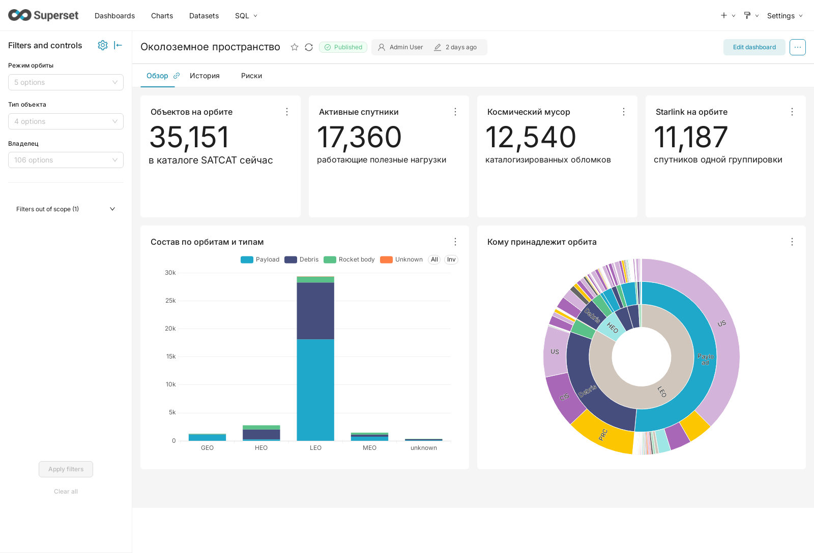

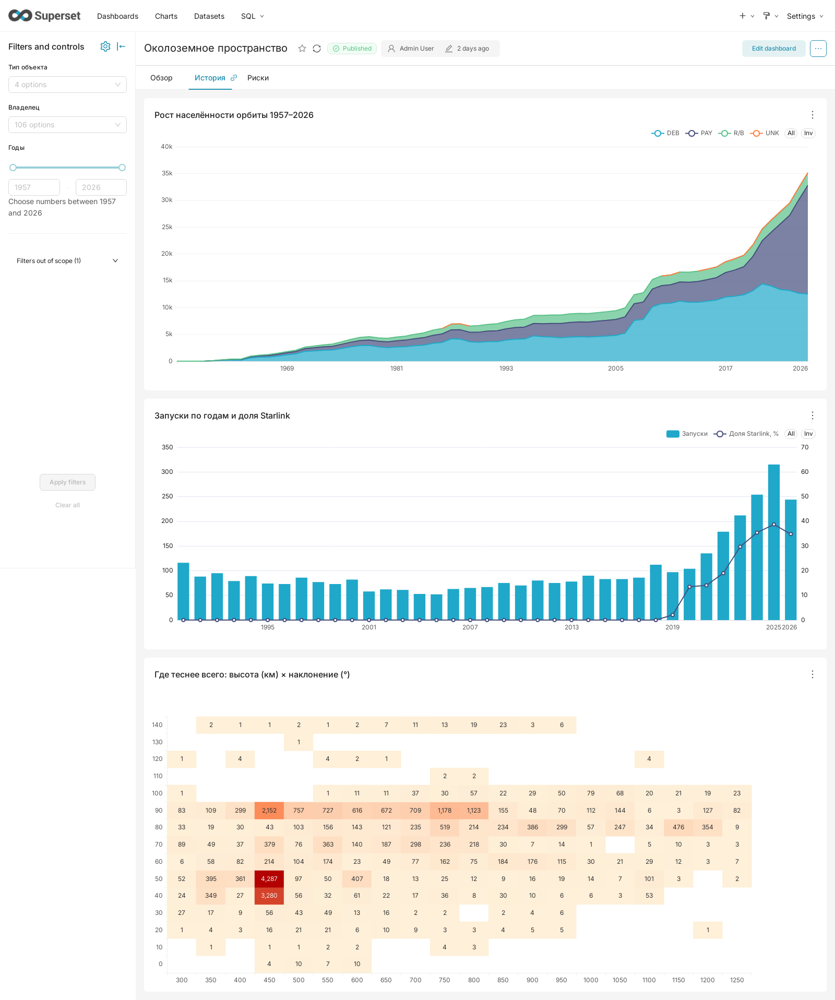

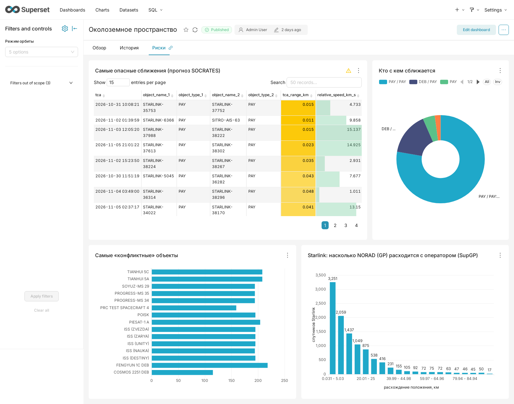

| График | Тип | Почему этот тип |
|---|---|---|
| Объектов на орбите / Активные / Мусор / Starlink | Big Number ×4 | ключевые числа, которые читаются за секунду |
| Состав по орбитам и типам | stacked bar | сравнение категорий (режимы) и их частей (типы); сразу видно, что LEO на порядок больше остальных |
| Кому принадлежит орбита | sunburst | иерархия режим → тип → владелец; доли на каждом уровне с длинным хвостом из 106 владельцев |
| Рост населённости орбиты 1957–2026 | stacked area | накопленная величина во времени по типам; ступеньки разрушений 2007/2009/2021 видны как скачки слоя DEB |
| Запуски по годам и доля Starlink | bar + line, две оси | абсолютное число и доля на одной шкале времени; столбцы и линия не конкурируют за одну ось |
| Где теснее всего: высота × наклонение | heatmap | плотность по двум непрерывным осям; оболочки Starlink — тёмные клетки |
| Самые опасные сближения | table с условным форматированием | нужны конкретные пары, время и значения; подсветка вероятности ≥ 10⁻³ и дистанции < 100 м |
| Кто с кем сближается | donut | доля 4 категорий пар, всего несколько секторов |
| Самые «конфликтные» объекты | horizontal bar | ранжирование с длинными подписями-именами |
| Starlink: GP vs SupGP | histogram | распределение расхождений; видны основная масса и хвост |

### Дашборд «Космос в 3D»

Вкладки дашборда встраивают через iframe страницы сервиса `globe` (globe.gl + satellite.js).
Данные он берёт из витрин через `/ch/` (nginx → ClickHouse под пользователем `superset`),
поэтому учётных данных в странице нет.

- **«Сейчас».** Около 17 тыс. спутников из `orbit_elements`, положения считаются по SGP4 в
  браузере в реальном времени. Есть фильтры по режиму и Starlink, слои «опасные пары»,
  «космодромы», «дуги космодром → GEO», «витки МКС/Тяньгуна/Хаббла/Starlink», «где сближения».
- **«Хроника 1957–2026».** Таймлапс по `chronicle`: 69 тыс. объектов появляются в год
  каталогизации и исчезают при сходе с орбиты; события эпохи подписаны.

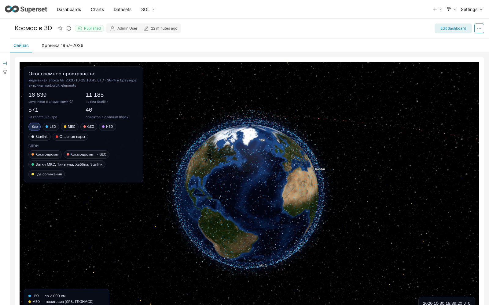

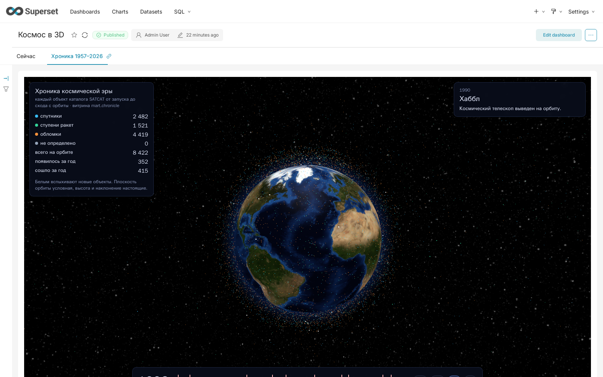

Глобус специально вынесен на отдельный origin (`:8090`). Chrome притормаживает анимацию
в скрытом iframe только с чужого origin. Когда страницы отдавал сам Superset, оба WebGL-глобуса
анимировались одновременно, даже на неактивной вкладке, и дашборд заметно тормозил.

## 6. OpenMetadata

### 6.1 Наполнение каталога

Контейнер `om-ingest` ([`openmetadata/ingest.py`](../../openmetadata/ingest.py)) раз в час
выполняет шаги по порядку:

1. **Ingestion-воркфлоу** [`openmetadata/workflows/`](../../openmetadata/workflows):
   ClickHouse (схемы `ods`, `stage`, `rv`, `bv`, `mart`, `meta`; временные `__new` исключены),
   бакет `raw` в SeaweedFS, Superset (графики, дашборды, датасеты). Lineage
   `mart → датасет Superset → дашборд` OpenMetadata строит сам по метаданным Superset
   (12 рёбер; графики не узлы графа, они входят в дашборд).
2. **Lineage пайплайнов** — тот же код, что в DAG `publish_lineage` (§6.2).
3. **Каталог как код** — [`openmetadata/catalog.yaml`](../../openmetadata/catalog.yaml),
   который применяет [`catalog.py`](../../openmetadata/catalog.py). Повторный прогон ничего не
   меняет (0 правок). В каталоге заданы:
   - описания сервисов, 6 схем, 48 таблиц и 98 колонок, 13 графиков, 2 дашбордов, 10 пайплайнов;
   - владелец — команда «Платформа данных»;
   - классификация `Layer` (ODS / Stage / RawVault / BusinessVault / Mart / Meta) и Tier:
     Tier1 — 12 витрин для дашбордов, Tier2 — business vault и служебные витрины, Tier3 — ods,
     stage, rv, meta;
   - глоссарий `SpaceObjects` из 12 терминов (NORAD ID, GP, SupGP, TCA, Debris, Starlink…),
     термины привязаны к колонкам;
   - домен «Околоземное пространство» и дата-продукт «Аналитика околоземного пространства»
     (витрины Tier1 и дашборды);
   - KPI (§6.4).
4. **Тесты качества** (§6.3).

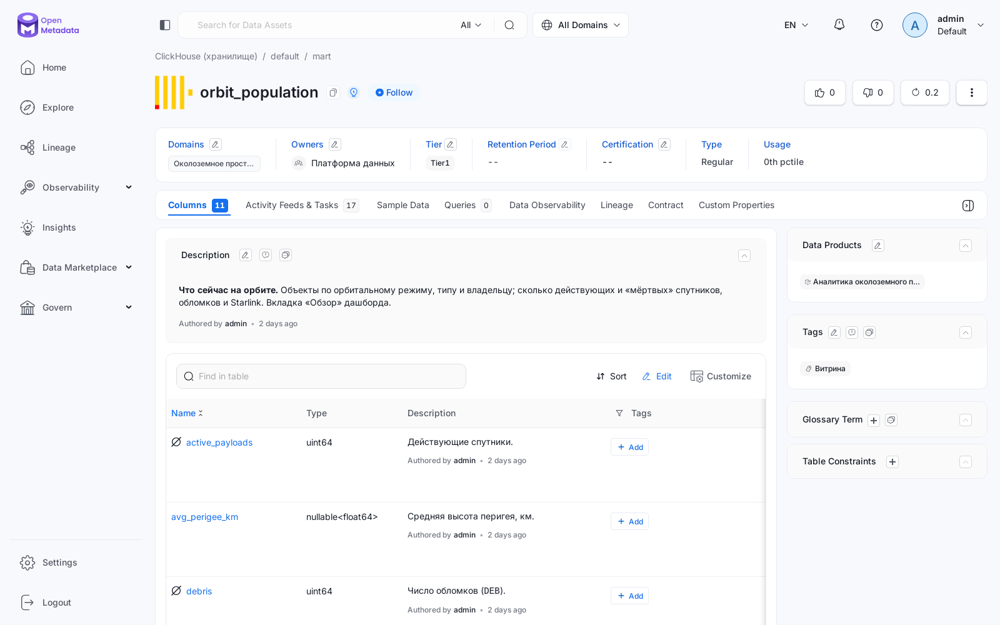

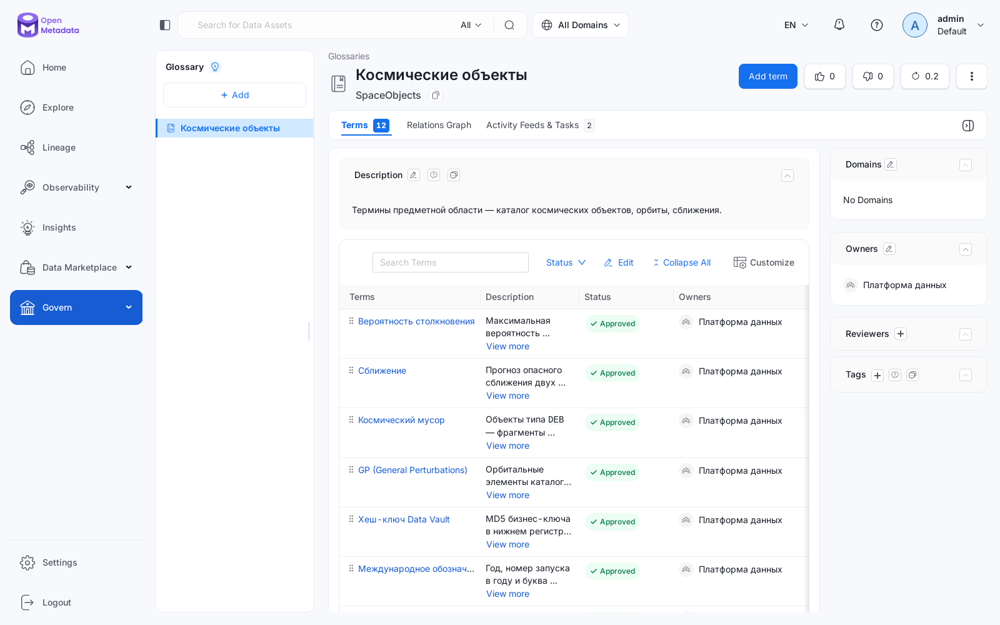

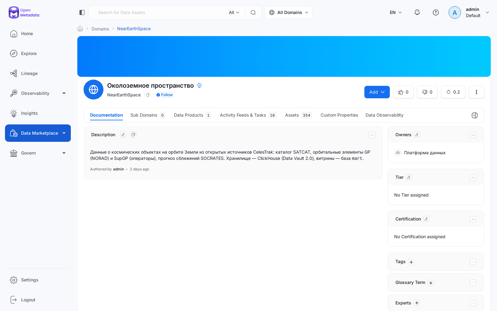

### 6.2 Lineage

Рёбра не прописаны вручную: их выводит из нашего кода
[`plugins/celestrak/lineage.py`](../../plugins/celestrak/lineage.py). Для каждого SQL-шага
цель берётся из `INSERT INTO` / `CREATE TABLE` / `CREATE VIEW`, источники — из `FROM` / `JOIN`.
Python-шаги (загрузка S3 → ODS, орбитальные витрины) перечислены явно.

| Шаги | Откуда берутся рёбра | Пайплайн |
|---|---|---|
| S3 `raw` → `ods.<source>` | `ingest_<source>` | `ingest_*` |
| `ods` → `stage` → `rv` | `sql/vault/load/<source>/*.sql` | `vault_satcat`, `vault_orbit`, `vault_conjunction` |
| `rv` → `bv` | DDL представлений + `sql/vault/bv/*.sql` | `vault_business` |
| `rv`/`bv` → `meta.dq_results` | `sql/dq/*.sql` | `data_quality` |
| `bv`/`rv`/`meta` → `mart` | `sql/mart/*.sql` + орбитальные витрины | `build_marts` |
| `mart` → Superset | ingestion Superset | — |

Всего 99 рёбер. Каждое привязано к пайплайну (DAG Airflow) и несёт свой SQL. Публикует их
DAG `publish_lineage` после каждой сборки витрин: Asset `mart_all`, подключение `openmetadata`.
Рёбра на таблицы, которых ещё нет в каталоге, пропускаются.

Полная цепочка для прогноза сближений: бакет `raw` → `ods.socrates` → `stage.socrates` →
`rv.sat_conjunction` → `bv.conjunction_current` → `mart.conjunction_risk` → датасет Superset.
Параллельно идёт ветка качества `rv.sat_conjunction` → `meta.dq_results` →
`mart.dq_checks` / `mart.pipeline_health`.

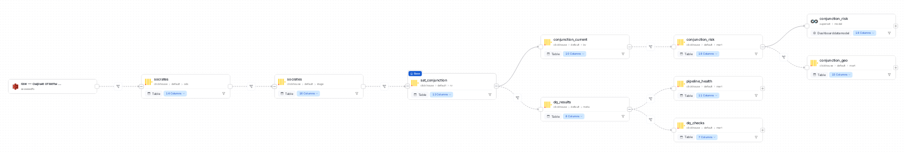

Глубина просмотра lineage в интерфейсе — 3 шага в каждую сторону (`lineage_depth` в
`catalog.yaml`; больше сервер не допускает). Этого хватает, чтобы от `rv` увидеть цепочку
от S3 до Superset целиком.

### 6.3 Тесты качества

[`openmetadata/quality.py`](../../openmetadata/quality.py) создаёт тесты на **все 48 таблиц**
и прогоняет их через TestSuite-воркфлоу OpenMetadata. Всего 226 тестов:

| Тест | Сколько | Что проверяет |
|---|---:|---|
| `tableRowCountToBeBetween` | 48 | таблица не пуста |
| `tableColumnCountToEqual` | 48 | схема не изменилась |
| `columnValuesToBeNotNull` | 73 | ключи, hash keys, `load_dts` |
| `columnValuesToBeUnique` | 17 | ключи хабов, бизнес-ключи витрин |
| `columnValuesToBeBetween` | 25 | физические диапазоны: эксцентриситет, наклонение, вероятность, высоты |
| `tableCustomSQLQuery` | 15 | все 15 проверок `sql/dq` ЛР2 |

Результат: 223 успешны, 3 упали. Это те же три warning-проверки, что и в DAG `data_quality`,
то есть реальные особенности данных, а не ошибки загрузки:
- `launch_consistency` (1) — у запуска две площадки;
- `objects_without_catalog` (459) — объекты из GP/SOCRATES, которых нет в SATCAT;
- `orbit_epoch_future` (5) — предсказанные элементы высоких орбит.

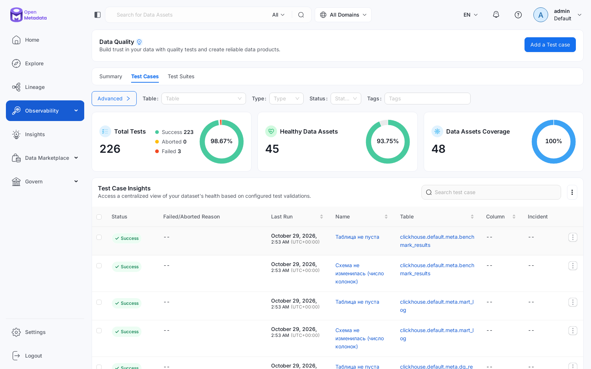

### 6.4 KPI

Два KPI Data Insights для домена «Околоземное пространство», срок — 28.10–31.12.2026:

| KPI | Метрика | Цель | Факт |
|---|---|---:|---:|
| Описания у ресурсов | доля ресурсов с описанием | 95 % | 100 % |
| Владельцы у ресурсов | доля ресурсов с владельцем | 100 % | 100 % |

Значения считает приложение Data Insights, `om-ingest` запускает его после каждого прогона.
Если появится новая таблица без описания в `catalog.yaml`, KPI опустится ниже цели.

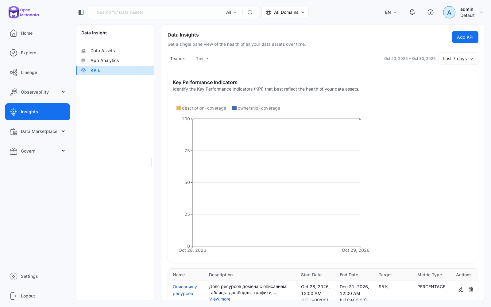

## 7. Наблюдения и ограничения

- **«Сближения» без риска.** В топе «конфликтных» объектов — модули МКС, «Союз», «Прогресс»
  и пары вроде Tianhui 5C/5D (208 сближений). Это пристыкованные корабли и спутники, летящие
  строем. SOCRATES считает их сближениями в каждом прогнозе. По той же причине у пар Starlink
  на дистанции 10–20 м `max_prob` = 1: SOCRATES даёт максимально возможную вероятность, а не
  оценку по реальным ковариациям. Следующий шаг — исключать известные стыковки и группировки
  в витрине.
- **История снимков короткая** (с 16.10, с паузой 17–27.10). Поэтому временные ряды строятся
  по датам SATCAT (запуски и сходы с 1957 года), а не по истории vault.
- **Точность SGP4** — точность самих GP (~1 км на эпоху), растёт со временем от эпохи.
  Для карт и глобуса этого достаточно, для расчёта сближений — нет: для этого есть SOCRATES.
- **Ресурсы.** OpenMetadata с Elasticsearch — самая тяжёлая часть стенда (~2.5 ГБ: сервер 1 ГБ, Elasticsearch 1.4 ГБ). Поэтому она
  вынесена в профиль `meta` и поднимается только тогда, когда нужна.
